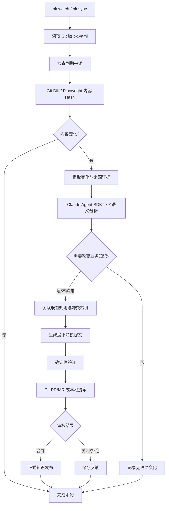

# BK — Git 原生业务知识自动演进 CLI｜产品需求文档（PRD）

> **文档版本**：v1.0（开发基线草案）  
> **编写日期**：2026-11-05  
> **状态**：已讨论方案整理，待开发评审  
> **产品代号**：`bk`（暂定，CLI 命令与仓库名称可调整）  
> **配套文档**：[02-TECHNICAL-DESIGN.md](./02-TECHNICAL-DESIGN.md)

## 0. 执行摘要

BK 是面向 AI 编程 Agent 的**本地优先、Git 原生、可自动演进的业务知识维护命令行工具**。用户将需要监听的 Git 仓库、内外网网页及处理策略写进知识仓库内的 `bk.yaml`；在有访问权限的开发电脑上运行 `bk watch` 后，工具按配置周期执行增量采集、业务语义识别、知识关联、差异生成、验证并创建 Git PR/MR，由人工批准后更新正式知识库。

BK **不**试图将整个代码仓库复制或概括为另一套代码 Wiki。代码、测试是业务规则**发现/核验的证据**，PRD、业务设计、规范是业务意图的**主要来源**。知识的正式产物是**业务规则、业务流程、领域术语、业务决策和约束**，而非类、方法、调用链的机械摘要。

**北极星体验**：安装 CLI → 克隆/初始化知识 Git 仓库 → 维护 `bk.yaml` → 首次登录需要认证的网页 → 运行 `bk watch` → 只需审核有价值的业务知识变更 PR/MR；Claude Code、Codex 等 AI 编程工具直接读取被批准的 Markdown/Mermaid。

## 1. 背景与问题

随着 Claude Code、Codex 等 AI 编程 Agent 被用于多个需求并行开发，Agent 能快速读取源代码，却难以稳定获取散落在 PRD、网页 Wiki、设计图、业务讨论结论、跨服务测试中的**关键业务事实与业务边界**。这些内容可能与代码处于不同系统、不同更新节奏；手工维护 `AGENTS.md` 或业务 Wiki 成本高，且会逐渐过时。

现有网页同步、文件转 Markdown、代码 Wiki 工具主要解决“**源内容怎么抓取与转换**”；本产品的核心问题是：**业务发生变化时，哪些已批准的业务知识应当变化，以及怎样让变化可追溯、可审核、可回滚。**

举例：专题活动规则规定“SPU 报名提交后锁价，直至拒绝、撤回、退出或活动结束”；某次 PRD 改写了退出条件，或者代码变更意外放宽价格校验。BK 应识别涉及的业务规则，区分“需求正式变更”与“代码实现偏差”，生成明确引用来源的待审核差异，而不是对整个商品服务重新总结。

## 2. 产品定位、目标与原则

### 2.1 定位

**Self-Evolving Business Knowledge for AI Coding Agents**：一个本地运行、通过 Git 治理的业务知识编译和演进 CLI。

### 2.2 核心目标

- **G1｜低维护**：用户通过配置一次知识源清单，长期由 `bk watch` 自主增量采集与分析。
- **G2｜高价值**：只沉淀会影响业务判断、业务约束、跨系统行为的关键知识；过滤代码重构、格式修改等噪声。
- **G3｜可追溯**：每条知识有稳定标识、来源定位与版本证据；对新增、变更、冲突、失效有审计链。
- **G4｜自动演进**：检测真实语义变化，定位受影响规则，生成最小知识 Diff，经审核合并后才成为正式知识。
- **G5｜易部署**：一个 TypeScript CLI、一个 Git 知识仓库、一个本地 SQLite；运行在有内网访问权限的开发电脑，不要求服务器或 Web UI。
- **G6｜Agent 友好**：知识产物为目录清晰、可按需读取的 Markdown 与 Mermaid，支持多种 AI Coding Agent 使用。

### 2.3 设计原则

1. **Git 为共享事实源**：知识内容、知识源清单、规则与技能约定版本化；本地缓存、浏览器认证和 SQLite 不进 Git。
2. **业务知识优先**：不全量编译代码；代码与测试用例是证据与变更触发源。
3. **有证据才提案**：规则更新必须有可定位来源；无法确定时输出“待确认/冲突”，不伪造事实。
4. **增量优先、可复算**：只重处理发生实质变化的资料；失败可重试，删除本地状态后可重建。
5. **人审生效**：允许自动生成分支和 PR/MR；默认禁止自动合并正式知识规则。
6. **模型可替换、工具独立**：第一版使用 Claude Agent SDK；扫描、调度、存储、校验和 Git 审核不依赖特定模型。
7. **内网安全**：浏览器与代码读取遵守原有权限；网页是非可信输入；模型外传须符合公司数据政策。

## 3. 目标用户与场景

| 用户 | 主要痛点 | 期望收益 |
|---|---|---|
| 技术负责人/架构师 | 业务规则散落，知识无人维护，Agent 经常遗漏关键约束 | 跨团队共享经过审核的业务上下文 |
| 使用 AI Coding 的研发工程师 | 每次需求都要重复解释业务；多 Worktree 不同任务理解不一致 | Agent 提前了解业务规则并减少返工 |
| 产品经理/业务负责人 | PRD 改了却无法确认研发知识是否同步 | PR/MR 审核业务语义差异与冲突 |
| 知识库维护者 | 人工复制、整理、更新文档费时 | 定期只审核必要修改 |
| 内网研发团队 | Wiki、需求系统需要认证，云端抓取服务访问不到 | 本地 Playwright 利用已有授权读取资料 |

### 3.1 核心用户旅程

**首次安装**：安装 CLI、初始化/克隆知识仓库、确认模型鉴权、填写 `bk.yaml`、通过 `bk browser login <source>` 完成内网页面认证、执行 `bk doctor` 和 `bk sync --dry-run`，人工审核首批候选业务知识。

**日常运行**：`bk watch` 常驻运行；到期时扫描指定仓库和网页，未变化直接跳过；发现业务语义变化时生成候选知识 Diff，关联证据，创建或更新 PR/MR；审核通过后下次运行刷新本地状态与关联关系。

**开发消费**：研发 Agent 阅读 `AGENTS.md`/导航，按业务域加载已批准规则，再去对应 Worktree 阅读实时源码；未审核的候选知识不得作为线上已生效规则。

**异常处理**：网页登录失效通知重新登录；模型服务不可达保留变更任务；同源 PR 已存在则更新它；来源内容冲突则输出报告等待确认。

## 4. 产品范围与非目标

### 4.1 V1 范围

- 本地 TypeScript/Node.js CLI，`bk watch` 内建周期调度；支持手动 `bk sync`、`bk scan`、`bk analyze` 等。
- Git 源：PRD/设计文档仓库、业务服务代码仓库、测试仓库；按分支、路径、文件类型与内容变更增量识别。
- 网页源：**统一 Playwright**，支持内外网、动态渲染、持久登录 Profile、翻页/展开等 Agent 受控浏览。
- 网页文本、表格、图片转规范化 Markdown；图示图片可经多模态理解转换为 Mermaid；非图示采用文本/表格描述。
- 关键业务规则自动提取、规则级变更检测、来源追溯、冲突识别与证据不足识别。
- Git 知识库结构化管理，生成最小变更提案，支持 Gitea/GitHub/GitLab 通过 `tea`/`gt`、`gh`、`glab` 创建或更新 PR/MR。
- SQLite 本地状态、缓存、失败恢复、任务历史与日志；知识源和调度设置随知识库 Git 管理。
- 初期通过 Claude Agent SDK 完成业务语义分析及多模态工作；无 Web 后台。

### 4.2 明确不做

- 不构建完整的 CodeWiki，也不把所有类、API、调用链、SQL 都转成长期知识。
- 不以会话聊天记录作为业务知识主来源，不做通用 Agent 长期聊天记忆。
- 不引入必须在线运行的知识服务器、向量库或 Open WebUI 依赖。
- 不自动合并重要业务知识变更，不自动修改业务系统或向内网页面提交业务数据。
- 不绕过 SSO/MFA/权限认证，不做跨用户共享浏览器凭据。
- 不承诺所有图片都能无损转 Mermaid；对 UI、照片、统计图采用更适合的表达。
- 不做开箱即用的全量企业知识搜索平台；第一阶段仅 Git/网页两个 Source Adapter。

## 5. 功能需求（FR）

> 优先级：P0 首次可用闭环必须；P1 产品可持续使用；P2 规模化增强。各功能应提供日志、错误提示、可验证状态。

### 5.1 初始化与配置

| ID | 优先级 | 需求与行为 | 关键验收 |
|---|---|---|---|
| FR-001 | P0 | `bk init [path]` 初始化知识仓库模板、`bk.yaml`、`AGENTS.md`、`.gitignore`。 | `.bk/` 默认 Git 忽略；不覆写已有文件。 |
| FR-002 | P0 | 知识源、调度、知识规范、审核方式全部由知识仓库根目录 `bk.yaml` 配置，并进入 Git。 | 克隆配置可还原来源清单；不包含明文凭据。 |
| FR-003 | P0 | `bk doctor` 校验配置、Git、Node、Playwright 浏览器、Agent 鉴权、Git 平台 CLI。 | 输出每项通过/失败及修复提示。 |
| FR-004 | P1 | `bk source add/list/remove/test` 管理来源，并对 `bk.yaml` 产生普通 Git Diff。 | 新来源下一轮生效；删除来源不自动删除正式知识。 |
| FR-005 | P1 | `bk watch` 检测 `bk.yaml` 更新、校验成功后热加载。 | 无效配置不破坏上一个有效运行配置。 |

### 5.2 Git 知识源采集

| ID | 优先级 | 需求与行为 | 关键验收 |
|---|---|---|---|
| FR-010 | P0 | 支持 Git SSH/HTTPS 地址、分支、include/exclude 路径、来源角色（PRD/设计/代码/测试）。 | 配置 2 个仓库可完成首次扫描。 |
| FR-011 | P0 | 首次建立快照；后续 `git fetch` 比较上次**成功处理**的 Commit 与最新目标 Commit，产生文件和内容 Diff。 | 新增、修改、删除、重命名均可检测；无变化不触发语义分析。 |
| FR-012 | P0 | 代码差异只作为发现业务规则变化的线索，先过滤纯格式、依赖升级、机械重构等。 | 单纯重构通常不生成业务知识 PR。 |
| FR-013 | P1 | 对跨 Commit 重写、强推、分支切换提供安全回退：无共同祖先或差异异常时重新建立待验证快照，不默默跳过。 | 发生 force-push 后无遗漏，也不盲目删除规则。 |
| FR-014 | P1 | 支持测试用例变动作为边界条件的佐证，但不能独立把现有行为认定为正式业务决策。 | 测试与批准规则矛盾时输出冲突。 |

### 5.3 网页与浏览器采集

| ID | 优先级 | 需求与行为 | 关键验收 |
|---|---|---|---|
| FR-020 | P0 | 全部网页统一由 Playwright 加载，不区分静态/动态爬虫实现。 | JS 渲染网页能够采集完整可见正文。 |
| FR-021 | P0 | `bk browser login <source>` 打开有界面浏览器，允许用户手动 SSO、扫码、MFA；浏览器 Profile 持久化。 | 重启 CLI 后无需重新登录（认证未过期时）。 |
| FR-022 | P0 | 以 Profile 为单位独占使用；自动采集与 Agent 智能浏览共用同一认证上下文。 | 并行任务不争抢同一 `userDataDir`。 |
| FR-023 | P0 | 采集页面正文、标题、表格、图片及来源 URL；规范化内容后计算 Hash。 | 页面导航栏/时间戳等噪声变化通常不触发知识提案。 |
| FR-024 | P1 | Claude Agent SDK 可调用受控 Playwright 工具进行点击、搜索、滚动、展开、分页、截屏、提取内容。 | 复杂内网页面无需预写脚本也能成功读取。 |
| FR-025 | P1 | 对智能浏览成功的稳定步骤可生成 Playwright 脚本草案，经本地验证与代码审核后复用。 | 页面变更导致脚本失效时降级到 Agent 重新探索，不无限重试。 |
| FR-026 | P1 | 支持限定来源域名/URL、最大页数、深度、超时、重试、图片限制、robots/站点策略约束。 | 不越权访问、不会无限爬取或跨域扩散。 |
| FR-027 | P0 | 登录过期、权限不足、验证码等情况转为 `auth_required/blocked`，用户可查看并手动处理。 | 不尝试绕过认证，不误标“无变化”。 |

### 5.4 内容编译与图片处理

| ID | 优先级 | 需求与行为 | 关键验收 |
|---|---|---|---|
| FR-030 | P0 | HTML 正文与表格标准化为 Markdown，保存页面标题、URL、采集时间、规范化 Hash。 | 重要表格行列与链接保留。 |
| FR-031 | P1 | 图片先分类（架构/流程/时序/ER/状态、统计、UI、照片等），再选择 Mermaid、表格或文本描述。 | 非关系图不强制转 Mermaid。 |
| FR-032 | P1 | 图示图片采用“视觉理解 → 结构化中间表示 → Mermaid → 语法校验 → 必要时语义复核”流水线。 | 生成 Mermaid 可解析；不确定关系标为待确认。 |
| FR-033 | P1 | 原始图片保存在本地缓存或可选安全对象存储，正式知识保留来源 URL、图片 Hash 与验证线索。 | 图片可复查；默认不向 Git 提交敏感原图。 |
| FR-034 | P1 | 对模型调用和多模态结果按内容 Hash、模型/提示词版本缓存。 | 相同内容不重复消耗多模态推理额度。 |

### 5.5 业务知识抽取、关联与演进（核心差异化）

| ID | 优先级 | 需求与行为 | 关键验收 |
|---|---|---|---|
| FR-040 | P0 | 从来源提取关键业务规则、业务流程、领域词汇、约束与决策，拒绝机械代码摘要。 | 输出业务含义及证据，非类方法罗列。 |
| FR-041 | P0 | 每条重要规则具有稳定 Rule ID、业务域、状态、来源引用、相关规则和生命周期。 | 修改标题或路径不随意更换 Rule ID。 |
| FR-042 | P0 | 变更到来时定位影响的现有规则，输出 `add/update/no_change/conflict/deprecate_candidate` 决策。 | 不对所有文档全量重写。 |
| FR-043 | P0 | 比对 PRD、设计、代码和测试的语义差异，区分“需求变化”“实现行为变化”“来源冲突”。 | 代码与 PRD 冲突时不得擅自改正式业务规则。 |
| FR-044 | P0 | 每个候选变化必须包含新旧规则、来源定位、推断说明、置信/证据充分性、潜在影响。 | 证据缺失或冲突的更新不得生成可直接批准的规则。 |
| FR-045 | P1 | 规则之间建立轻量关联索引，支持按来源反向定位受影响规则。 | 单个 PRD 段落修改仅命中相关候选规则。 |
| FR-046 | P1 | 保留 `approved`、`approved_pending_release`、`deprecated`、`disputed` 等状态或等价方案。 | 待上线规则不会被默认描述为当前生效规则。 |
| FR-047 | P1 | 审核拒绝/编辑结果记录为结构化反馈，用于改善去重与下一次提案。 | 同一无意义变更不持续产生重复提案。 |

### 5.6 审核、Git 与知识发布

| ID | 优先级 | 需求与行为 | 关键验收 |
|---|---|---|---|
| FR-050 | P0 | 正式知识库为普通 Git 仓库；自动生成独立分支/工作区和最小 Markdown/Mermaid Diff。 | 不直接修改主分支；不覆盖用户未提交文件。 |
| FR-051 | P0 | 通过统一 Provider 适配 Gitea（`gt` 或旧 `tea`）、GitHub（`gh`）、GitLab（`glab`）创建 PR/MR。 | 三类平台至少各有一套自动化联调测试。 |
| FR-052 | P0 | PR/MR 描述包含业务摘要、变更规则清单、来源链接、风险、未解决冲突和验证结果。 | 审核人员无需复查所有原始源即可定位依据。 |
| FR-053 | P0 | 只创建有实质知识差异的提案；同一来源变更/规则组合去重，已有 PR 可追加更新。 | 重跑 `bk sync` 不重复创建相同 PR。 |
| FR-054 | P0 | 监测 PR/MR 审核状态；合并后刷新正式知识及规则索引；关闭/拒绝后记录原因。 | 仅在合并且目标分支包含变更时标记正式知识已更新。 |
| FR-055 | P1 | 本地模式可只生成补丁和待审报告，无远端 Provider 时仍可独立运行。 | `bk sync --local` 可完成同一流水线。 |
| FR-056 | P0 | 默认不自动合并，特别是交易、支付、结算、权限等高风险规则。 | 未经人工审核不能生效。 |

### 5.7 调度、状态和运维

| ID | 优先级 | 需求与行为 | 关键验收 |
|---|---|---|---|
| FR-060 | P0 | `bk watch` 自带长期运行调度循环，按每个来源的独立 `interval` 执行。 | 不依赖 Claude Code 定时器、launchd 或外部调度器。 |
| FR-061 | P0 | `bk sync` 单次执行复用 watch 的同一流水线；`bk scan` 不调用模型。 | 单次和循环模式产生一致结果。 |
| FR-062 | P0 | SQLite 位于知识仓库 `.bk/state.sqlite`，`.bk/` 被 Git 忽略。 | 本地状态重建不修改正式知识。 |
| FR-063 | P0 | 任务状态、重试和检查点持久化，网络/模型/进程异常不得丢失未处理变化。 | 中途强制退出，重启后可恢复待办任务。 |
| FR-064 | P0 | 支持来源级并发限制、Agent 并发限制、Profile 锁、单实例 watch 锁。 | 不并发打开相同浏览器 Profile。 |
| FR-065 | P1 | `bk status`、`bk history`、`bk proposals`、结构化日志和运行统计。 | 能区分无变化、失败、待审、权限异常。 |
| FR-066 | P1 | 每轮记录模型消耗、处理耗时、来源规模及知识提案效果。 | 可以按来源/周期评估质量与成本。 |
| FR-067 | P1 | 提供安全限额与暂停能力，如页面数、变更量、模型预算、分析超时。 | 超预算暂停并保留状态，不失控运行。 |

## 6. 主要业务流程与状态

### 6.1 自动演进主流程



### 6.2 首次建立业务知识

1. 用户配置来源，指定其角色（需求文档/设计/代码/测试/外部规范）。
2. CLI 获取首个快照，提取文档目录、标题、正文、图片；代码仅做业务规则相关的抽样/定位辅助。
3. Agent 从来源中提出业务概念、规则和流程候选，给出来源定位与潜在不确定项。
4. 生成初始化知识分支和 PR/MR，人工确认准确性、粒度和是否应该长期保存。
5. 合并后才成为基线知识；规则 ID 和来源关联进入 Git。

### 6.3 增量变化

- **PRD 变化**：优先分析业务语义，识别新增/修改/删除的规则；根据批准状态提出变更。
- **代码变化**：先按文件及 Diff 过滤，再识别行为变化；如果与已批准规则冲突，生成冲突报告而不是改规则。
- **测试变化**：可能揭示未沉淀的边界或现有实现偏差；需证据确认。
- **网页变化**：按规范化正文与图片 Hash 检测；导航/UI 噪声尽量过滤。
- **来源删除**：生成“来源失效/规则需复核”候选；禁止直接删除仍被其他来源支持的正式规则。
- **合并后再次扫描**：同步已批准规则索引，消除已完成候选。

### 6.4 示例：专题活动锁价规则

**原规则**：报名提交成功后不允许商家改价；解除条件为报名被拒绝、撤回、退出或活动结束。

**PRD 修改**：新增一种经批准的解除条件。

**期望**：BK 定位规则 `PROMO-PRICE-LOCK-001`，比较新旧条款，生成只包含相关条款变更的 PR，并附 PRD 段落链接、旧规则及风险提示；人工合并后 Agent 下次读取的是新版本。

**反例**：若只是在校验类中删掉锁价检查、PRD 未变化，BK 应报告“实现与已批准规则冲突”，不得将“可改价”直接写入正式规则。

## 7. CLI 用户界面（建议命令）

```bash
bk init [path]                   # 初始化知识仓库模板
bk doctor                        # 环境、权限、模型、Git 平台检查
bk source list                   # 查看已配置来源
bk source test <id>              # 验证一个源是否可访问
bk browser login <source-id>     # 打开可视浏览器进行人工登录
bk browser status <source-id>    # 检查认证与 Profile 状态
bk scan [--source <id>]          # 只发现变化，不调用 Agent
bk analyze [--source <id>]       # 分析待处理变更并创建候选
bk sync [--source <id>]          # 一次完整增量循环
bk sync --dry-run                # 预览，禁止远程写入/创建 PR
bk sync --local                  # 只在本地生成提案
bk watch                         # CLI 内置定时常驻循环
bk status [--json]               # 状态摘要
bk history [--limit 20]          # 检查/分析/提交历史
bk proposals                     # 待审核变更
bk validate                      # 规则、来源、Mermaid、链接校验
```

命令在开发前以 E2E 用例验证；命令名称暂定，统一提供 `--help`、`--json` 与有意义的退出码。

## 8. 知识内容与组织规范

### 8.1 知识目录

```text
business-knowledge/
├── bk.yaml                    # 监听来源与运行规则（Git）
├── AGENTS.md                  # Agent 读取指南（Git）
├── knowledge/
│   ├── trade/
│   ├── payment/
│   ├── marketing/
│   └── identity/
├── glossary/                  # 领域概念（Git）
├── decisions/                 # 决策与背景（Git）
├── diagrams/                  # Mermaid 代码（Git）
├── indexes/                   # 规则到来源的轻量关联索引（Git）
├── .bk/                       # 本地 SQLite、缓存、Profile，不进 Git
└── .gitignore
```

### 8.2 单条业务规则的必需信息

| 字段 | 说明 |
|---|---|
| `id` | 稳定规则 ID，不因文件路径变化而变化 |
| `domain` / `title` | 业务域/业务名称 |
| `status` | 审核状态和业务生效状态 |
| `statement` | 可执行且明确的业务规则表述 |
| `conditions` / `exceptions` | 生效条件、例外、边界 |
| `sources` | PRD/设计/代码/测试/网页的定位、版本、引用 |
| `related_rules` | 相邻规则和依赖关系 |
| `last_verified_at` | 上次核验时间，不能替代来源版本 |

禁止只保留无源总结。没有明确依据的模型推断应标记“待确认”，不能伪装成已批准事实。

## 9. 非功能需求（NFR）

| ID | 维度 | 要求 |
|---|---|---|
| NFR-01 | 部署 | 支持有内网访问权限的开发电脑；Node.js LTS，单 CLI 安装；无必需服务端。 |
| NFR-02 | 可恢复 | 崩溃重启后扫描未完成任务，至少一次处理 + 幂等去重；不得因失败移动成功处理检查点。 |
| NFR-03 | 安全 | 登录态及 SQLite 位于 `.bk/`，权限受限；API Key 环境变量/安全凭据管理；日志脱敏。 |
| NFR-04 | 访问控制 | Playwright 严格遵循来源域名白名单、只读浏览策略，禁止未授权的写入和越权动作。 |
| NFR-05 | 可信 | AI 输出均须 Schema 校验、来源引用校验、链接与 Mermaid 语法检查；冲突阻断自动批准。 |
| NFR-06 | 成本 | 内容 Hash 去重、定额预算、模型调用耗时及用量统计。 |
| NFR-07 | 并发 | 来源级并发可配置；同一来源、同一浏览器 Profile、同一目标 PR 的写入串行。 |
| NFR-08 | 可观测 | 结构化日志、每轮摘要、失败原因、最近成功点、待审核 PR 数量。 |
| NFR-09 | 兼容 | Gitea/GitHub/GitLab 审核；Markdown 可由不同 AI 编程工具消费。 |
| NFR-10 | 许可与开源 | CLI 源码及业务知识仓库分离；可独立发布开源 CLI，外部依赖遵守许可证。 |

## 10. 验收标准和质量指标

> 以下数值为**建议的内部验证门槛**，不是已达成的性能数据或行业基准。

### 10.1 必须通过的端到端场景

1. 在全新目录 `bk init` 后，知识配置与 `.gitignore` 正确生成；SQLite/Profile 不被 `git status` 追踪。
2. 监听内网私有 Git 和有 SSO 的内网网页，用户首次登录后重启仍能正常抓取（认证未过期）。
3. 未发生内容变化时不产生新模型调用与 PR/MR。
4. PRD 只修改一条业务规则，生成有来源证据的最小更新提案；不重写无关知识。
5. Git 代码仅做重构时通常不产生正式知识提案。
6. 代码行为与已批准 PRD 不一致时，输出冲突，不自动改正式规则。
7. 同一差异重复运行不会产生重复 PR/MR。
8. Agent 使用浏览器展开折叠内容/分页后能采集完整文档；浏览器 Profile 不并发使用。
9. 进程在采集、分析、提交阶段分别中断，恢复后不会漏处理或重复发布。
10. Gitea/GitHub/GitLab 可创建可审核提案；未合并前正式知识保持不变。
11. 图片关系图能生成合法 Mermaid；视觉不确定的内容被标记为待确认或降级描述。
12. 云模型不可用或数据策略不允许外发时，安全失败并保留待办，不偷偷切换未经批准模型。

### 10.2 建议的业务效果指标

| 指标 | 建议试点目标 | 说明 |
|---|---:|---|
| 关键业务规则变更召回率 | ≥90% | 用经人工标注的真实变更集检验，不用模型自己打分 |
| 提案采纳率 | ≥70% | 合并/人工确认有价值的提案占比 |
| 重复提案率 | 趋近于 0 | 同一来源变化/规则组合重复提案 |
| 未经审核正式知识写入 | 0 次 | 强制安全约束 |
| 人工知识维护时间 | 对比基线下降 ≥50% | 试点前后同口径测量 |
| 处理失败后变更丢失 | 0 次 | 故障注入测试 |

业务指标的统计口径与样本量在试点开始前冻结。召回率与提案采纳率可能冲突，优先避免漏掉关键的资金、交易与权限类业务变化，同时通过筛选降低噪声。

## 11. 版本规划与里程碑

| 阶段 | 交付范围 | 通过标准 |
|---|---|---|
| **V0.1：可运行采集器** | TypeScript CLI、配置与 Git、`bk watch`、SQLite、Git Diff、Playwright 持久登录、Markdown 规范化 | 无人值守发现实际变化，失败可恢复 |
| **V0.2：业务知识首次编译** | Claude Agent SDK、关键规则提取、Schema、证据引用、初始化候选 | 从真实 PRD 生成可审核知识 |
| **V0.3：知识自动演进** | 规则 ID/关联、语义 Diff、冲突检测、增量提案 | 业务规则变更能精准定位并产生最小 Diff |
| **V0.4：协作闭环** | `gt`/`tea`、`gh`、`glab`、PR/MR 去重、审核结果、反馈、监控 | 完整跑通自动提案→人工审核→知识发布 |
| **V0.5：视觉与复杂网页** | Agent 浏览、图片分类转 Mermaid/文本、浏览脚本复用及失败重探 | 需要交互的内网页面可稳定采集 |
| **V1.0：开源可用** | 安全加固、跨平台、安装/升级、示例仓库、回归测试、文档 | 非研发作者能依据 README 独立部署 |

> 智能浏览和图片编译属于明确的 V1 目标；为降低开发风险，复杂能力在 V0.5 完成。若首个试点强依赖复杂内网 Wiki，应提前将智能浏览最小能力前移至 V0.1/V0.2。

## 12. 风险与待验证假设

1. **业务规则提取质量**：模型可能把代码实现等同于业务意图。需用来源角色、结构化证据、审核阻断解决。
2. **内网页面可读性**：单页应用、虚拟列表、Canvas、嵌入文档、SSO 可能使采集不完整。需要交互提取与完整性判断。
3. **模型安全与费用**：Claude Agent SDK 不等于本地离线模型；企业需要合法模型鉴权、外网访问与数据分类审批。
4. **登录态失效**：SSO/MFA 到期后需用户重新认证；不得绕过。
5. **Git 文档同步时差**：PRD 已改、代码尚未发布；规则必须保留设计批准态和业务生效态的区别。
6. **重复运行与 Git 冲突**：多台电脑可能同时执行；初期建议一套知识仓库仅指定一个主要写入实例，其余只读/本地模式。
7. **爬虫副作用**：浏览器导航不得执行可能修改数据的按钮；限制域名、请求数和高危页面。
8. **来源真实性**：外部网页与代码仓库中都可能包含提示词注入或恶意文本，必须视为数据而非 Agent 指令。
9. **跨平台 CLI 差异**：`gt` 需要适配的 Gitea 版本，旧平台使用 `tea`；三种 Provider 的参数必须联调验证。

## 13. 待开发评审确认项

- 正式产品名称、npm 包名及 CLI 命令名（本文以 `bk` 举例）。
- 业务知识文档的统一模板：一条规则单文件还是按主题组合；建议规则 ID 为基础、按主题组织 Markdown。
- 企业内网能否访问 Anthropic/合规模型网关；模型鉴权和费用归属。
- 初期优先试点的业务域、代码仓库、PRD/Wiki 地址、PR/MR 平台。
- 是否将自动发现的浏览脚本纳入 PR 评审（建议需要）。
- 首个试点业务规则高风险分级、审批人和上线态确认机制。

## 14. 参考资料

- Open WebUI oikb：<https://docs.openwebui.com/ecosystem/knowledge-base-sync/>（借鉴多来源增量同步与 Daemon 设计，不依赖 Open WebUI）。
- Claude Agent SDK：<https://code.claude.com/docs/en/agent-sdk/overview>。
- Playwright Persistent Context：<https://playwright.dev/docs/api/class-browsertype#browser-type-launch-persistent-context>。
- Gitea CLI：<https://docs.gitea.com/cli/>；`gt` 替代 `tea` 的发布说明：<https://blog.gitea.com/release-of-gitea-cli-1.0.0/>。
- GitLab CLI：<https://docs.gitlab.com/cli/mr/create/>。

