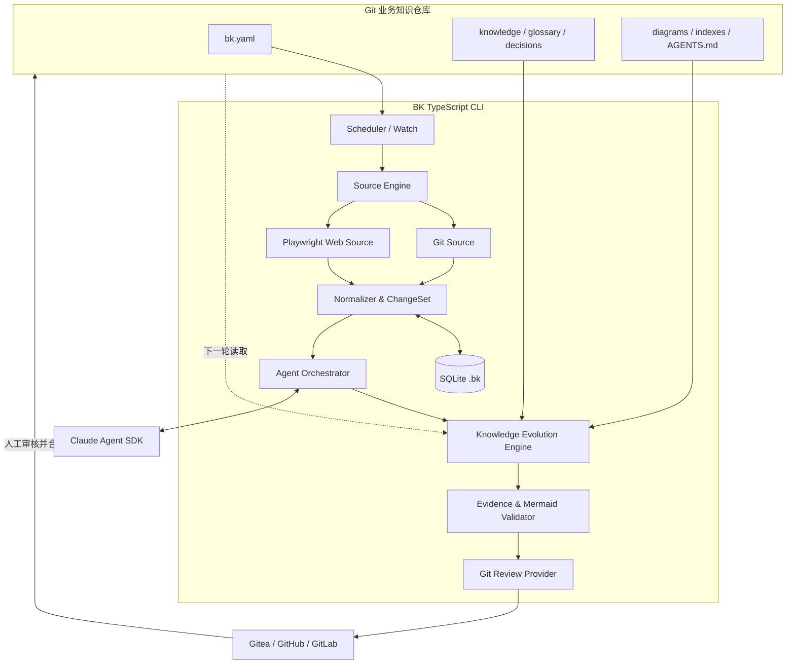
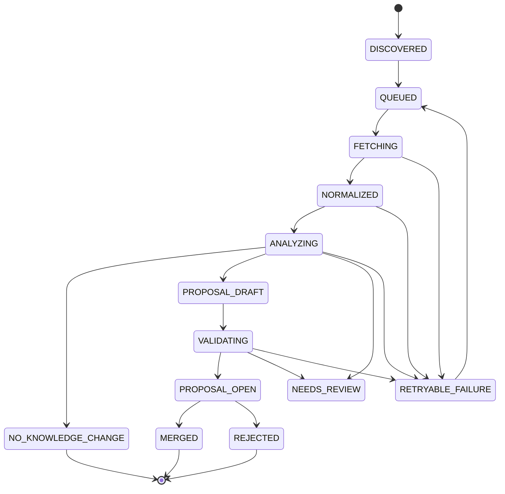
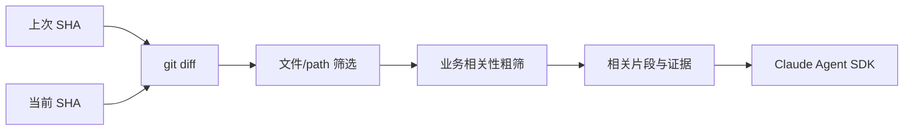
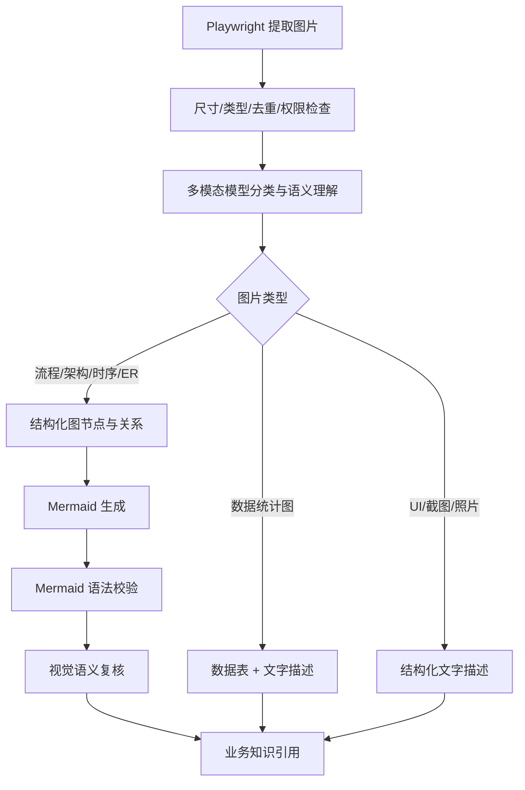
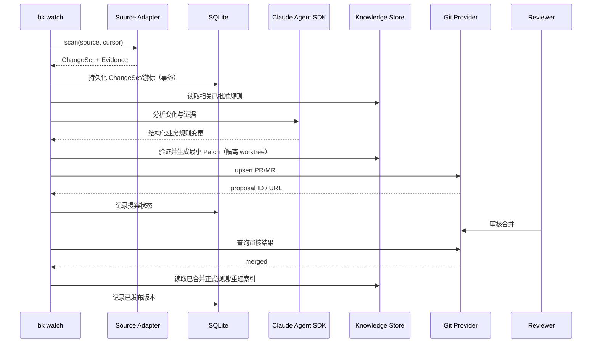

# BK — Git 原生业务知识自动演进 CLI｜技术设计文档

> **文档版本**：v1.0（详细设计草案）  
> **编写日期**：2026-11-05  
> **状态**：待技术评审  
> **对应 PRD**：[01-PRD.md](./01-PRD.md)  
> **实现原则**：TypeScript CLI 独立开发；借鉴 oikb 多来源同步、调度、状态、重试设计，但不依赖其 Python/Open WebUI 技术栈。

## 1. 技术决策一览

| 决策项 | 选型/原则 | 说明 |
|---|---|---|
| 语言 | TypeScript | 主工程语言，便于 Agent SDK、Playwright 与 JSON Schema 集成 |
| 运行时 | Node.js LTS（实施时锁定具体版本） | 无需 Rust、Go，避免多运行时复杂性 |
| CLI | Commander.js（候选） | 命令分发、帮助、参数校验 |
| 配置 | 根目录 `bk.yaml` + Zod | Git 版本管理，配置热更新要校验 |
| 常驻调度 | `bk watch` 自带运行循环 | 不依赖 Claude Code 定时任务、macOS launchd 或外部守护服务 |
| 智能推理 | `@anthropic-ai/claude-agent-sdk` | 内置 Agent 引擎；语义识别、视觉理解、工具交互 |
| Agent 抽象 | `AgentProvider` | 第一版 Claude Agent SDK；将来可替换 |
| 网页抓取 | Playwright（Chromium） | 统一处理静态和动态网页，允许 Agent 操作 |
| 浏览器认证 | `launchPersistentContext(userDataDir)` | 用户首登，持久 Profile；同 Profile 独占 |
| 本地状态 | SQLite | `.bk/state.sqlite`，不进 Git；任务与缓存元数据 |
| 代码增量 | Git CLI + `git diff` | 仅识别代码行为变化，不全量生成代码 Wiki |
| 内容归一化 | Readability/Turndown 等模块（作为 Playwright 后处理） | 内容提取与网页获取职责分离 |
| 图示文本化 | 多模态 Agent → 中间语义 → Mermaid/描述 | 先判图，再生成，校验语法与语义 |
| 正式知识 | Git + Markdown + Mermaid | 通过 `AGENTS.md` 等入口供 Agent 按需消费 |
| 审核平台 | `gt`/`tea`、`gh`、`glab` | Gitea/GitHub/GitLab，适配统一接口 |
| 数据库与搜索 | SQLite + 文件/规则索引 | 首期不要求向量数据库或知识图谱服务 |
| 模型鉴权 | 企业批准的模型认证方式 | SDK 不等于无成本/离线；凭据不进入 Git |

### 1.1 确认不采用的方案

- 不采用 oikb 代码分支进行二次开发；仅参考其 Source Sync/Daemon/Checksum/History 等成熟工程做法。
- 不使用 Firecrawl 作为必需依赖；内网网页由本地 Playwright 直接读取。
- 不用 `claude -p` 或独立 Claude Code 定时任务作为运行前提；CLI 内嵌 Agent SDK。
- 不使用 macOS `launchd` 定时调度；`bk watch` 仅在其进程存活时运行。
- 不把 Chat 会话历史变成知识库主来源；不将整个代码仓库预生成 Wiki。

## 2. 总体逻辑架构



### 2.1 分层职责

1. **CLI/Config**：命令、参数、配置发现/校验、输出；只读 `bk.yaml` 作为共享配置事实源。
2. **Scheduler**：周期决策、任务排队、限流、重试、优雅退出、锁与配置热更新。
3. **Source Engine**：Git Diff、Playwright 浏览器加载与智能读取；提供来源版本和可靠定位。
4. **Normalizer**：网页正文清洗、表格处理、图片分类清单、内容快照及规范化 Hash，输出 `ChangeSet`。
5. **Agent Orchestrator**：统一调用 Claude Agent SDK，传入有限上下文和受控工具，接收结构化业务语义结果。
6. **Knowledge Evolution**：规则定位、关联检索、合并候选、冲突判定、最小化 Markdown Diff。
7. **Validator**：Schema、来源证据、权限、Markdown/链接/Mermaid 合法性和风险分级。
8. **Review Provider**：独立工作区、提交、推送、PR/MR 创建/更新、状态同步。
9. **Local State**：SQLite、来源缓存、浏览器 Profile、分析任务中间产物；不入 Git。

原则上只有“**业务语义判读与视觉理解**”必须调用 Agent；抓取、差异、调度、文件写入、Git 管理均由确定性代码实现。

## 3. 仓库、安装与目录布局

### 3.1 CLI 工程仓库（独立开源）

```text
bk-cli/
├── package.json
├── tsconfig.json
├── src/
│   ├── cli/                  # commander commands / options / exit codes
│   ├── config/               # YAML + Zod schema / hot reload
│   ├── scheduler/            # watch loop / job lease / retry / mutex
│   ├── sources/
│   │   ├── git/              # fetch / revisions / git diff / role filters
│   │   └── web/              # Playwright crawler / DOM extractor / navigation
│   ├── browser/              # profile manager / login / lock / agent tools
│   ├── normalize/            # canonicalize / Markdown / assets / hashing
│   ├── state/                # SQLite migrations / repositories
│   ├── agent/                # Provider / Claude SDK / prompts / tool registry
│   ├── knowledge/            # rule matching / graph index / evolution
│   ├── validation/           # evidence / schema / mermaid / links
│   ├── review/               # git worktree / gitea / github / gitlab
│   ├── security/             # access policy / redaction / boundaries
│   └── telemetry/            # logs / metrics / audit
├── tests/
│   ├── unit/
│   ├── integration/
│   ├── e2e/
│   └── fixtures/
└── docs/
```

### 3.2 用户知识仓库（Git 管理的共享资产）

```text
business-knowledge/
├── bk.yaml                    # Source/Watch/Agent/Review 策略
├── AGENTS.md                  # 供 Claude Code/Codex 等读取的导航约定
├── knowledge/                 # 业务规则与流程正文
│   ├── trade/
│   ├── payment/
│   └── marketing/
├── glossary/                  # 统一领域术语
├── decisions/                 # 已批准的业务/架构决策
├── diagrams/                  # Mermaid 文本，图示说明
├── indexes/                   # 规则到来源的共享关联索引
├── .bk/                       # SQLite/缓存/鉴权/日志（Git 忽略）
│   ├── state.sqlite
│   ├── browser-profiles/
│   ├── git-mirrors/
│   ├── snapshots/
│   ├── assets/
│   ├── jobs/
│   ├── proposals/
│   ├── logs/
│   └── locks/
└── .gitignore
```

`.gitignore`：

```gitignore
.bk/
```

**隔离原则**：用户本机包含 Cookie、浏览器 Local Storage、Git 凭据引用、SQLite 和原始网页缓存；不得提交 Git。Git 保存的元信息应是可审核、非敏感、可由来源重新验证的规则和索引。首次迁移到新电脑时需要重新授权内网页面、重建本地缓存。

## 4. 配置文件详细设计

### 4.1 建议的 `bk.yaml`

```yaml
version: 1

knowledge:
  root: ./knowledge
  diagrams: ./diagrams
  indexes: ./indexes
  entrypoint: ./AGENTS.md
  target_branch: main

watch:
  enabled: true
  tick_interval: 1m
  max_concurrent_sources: 3
  max_concurrent_agents: 1
  retry:
    max_attempts: 3
    initial_delay: 30s
    max_delay: 30m
  budgets:
    max_pages_per_run: 200
    max_agent_jobs_per_run: 20

sources:
  - id: mall-prd
    type: git
    role: requirement
    url: ssh://git@gitea.internal/business/mall-prd.git
    branch: main
    include: ["prd/**", "design/**"]
    exclude: ["**/drafts/**"]
    interval: 30m

  - id: mall-backend
    type: git
    role: implementation
    url: ssh://git@gitea.internal/mall/backend.git
    branch: main
    include: ["**/*.java", "**/*.xml", "**/*.sql"]
    interval: 1h

  - id: mall-tests
    type: git
    role: test
    url: ssh://git@gitea.internal/mall/qa.git
    branch: main
    include: ["tests/**", "**/*Test.java"]
    interval: 1h

  - id: internal-wiki
    type: web
    role: requirement
    url: https://wiki.internal.example/business/
    interval: 6h
    browser:
      engine: chromium
      profile: internal-wiki
      headless: true
      interactive: true
      login_url: https://wiki.internal.example/login
    crawl:
      allowed_hosts: ["wiki.internal.example"]
      max_depth: 3
      max_pages: 150
      include: ["/business/**"]
      exclude: ["/admin/**"]
      wait_for: "main" # 可选，用于动态页面加载完成判断

agent:
  provider: claude-agent-sdk
  model: configured-by-environment # 部署时确定实际模型
  max_turns: 20
  allow_interactive_browser: true
  tool_policy: read-only-sources
  analysis_budget: medium

compiler:
  emit: [markdown, mermaid]
  image:
    enabled: true
    mode: diagram-or-description
    verify_semantics: true
  rules:
    require_source_evidence: true
    conflict_requires_review: true
    preserve_stable_ids: true

review:
  mode: pull-request # 或 local
  provider: gitea       # gitea | github | gitlab | auto
  cli: auto             # gt | tea | gh | glab | auto
  auto_merge: false
  proposal_branch_prefix: bk/knowledge/
```

**配置约束**：

- `sources[].id` 全仓唯一且稳定；数据源修改 URL 应显式迁移、避免错误复用检查点。
- `role` 是来源的**证据角色**，而非绝对权威；代码行为和业务意图冲突时始终待确认。
- `interval` 支持 `30m/1h/6h` 等；`tick_interval` 只能影响检测粒度，不能让来源扫描比配置更频繁。
- `target_branch` 指知识库正式分支，不能由网页/模型修改。
- `review.auto_merge` 在 V1 中必须为 `false`；即使用户手动配置为 `true`，CLI 也应拒绝高风险场景并提醒。
- API Key、Cookie、SSH 私钥、平台 Token **只能**由环境或已安装 CLI 的凭据系统提供。
- 配置仅是**建议 Schema**，代码实现以 Zod 版本化定义为准；未知键给出明确告警/拒绝策略。

### 4.2 配置热更新

`watch` 每一 Tick 比较 `bk.yaml` 文件 Hash → 新配置 Zod 校验 → 计算 Source 配置 Diff → 原子替换已生效配置。新增源执行首次抓取；删除源仅停用，不批量删除知识；来源地址发生实质修改需要新 Source Generation 或一次人工确认的迁移。已排队任务保留其创建时的配置快照，防止中途改变安全范围。

## 5. CLI 与应用服务接口

### 5.1 命令矩阵

| 命令 | 主要职责 | 是否调用 Agent | 是否写远程 Git |
|---|---|---:|---:|
| `bk init` | 知识库模板与配置 | 否 | 否 |
| `bk doctor` | 环境/权限/CLI 检查 | 否 | 否 |
| `bk source list/test` | 来源清单/连通性 | 否 | 否 |
| `bk browser login <id>` | 打开持久化 Chromium 并人工认证 | 否 | 否 |
| `bk browser status <id>` | 测试授权状态 | 否 | 否 |
| `bk scan` | Git/Web 增量发现，持久化 ChangeSet | 否 | 否 |
| `bk analyze` | Agent 语义分析、候选规则、冲突 | 是 | 否 |
| `bk validate` | 本地规则与提案验证 | 否（可选视觉复核） | 否 |
| `bk sync` | scan + analyze + proposal + review（单次） | 按需 | 按配置 |
| `bk sync --dry-run` | 检查与差异预览；无远端写入 | 按需，可缓存 | 否 |
| `bk watch` | 常驻循环，复用 sync Pipeline | 按需 | 按配置 |
| `bk status/history/proposals` | 查看任务与审核状态 | 否 | 否 |

V1 可额外提供 `--json` 机器可读输出、`--source id` 来源过滤和 `--local` 禁止远端写入。

### 5.2 建议的最小内部接口（示意，非可直接运行的实现）

```ts
type SourceRole = 'requirement' | 'design' | 'implementation' | 'test' | 'external-policy';
type ChangeKind = 'added' | 'modified' | 'deleted' | 'renamed';

interface SourceAdapter {
  readonly type: 'git' | 'web';
  scan(source: SourceConfig, previous: SourceCursor | null): Promise<ScanResult>;
  readEvidence(ref: EvidenceRef): Promise<EvidenceContent>;
}

interface ChangeSet {
  id: string;                  // deterministic or unique immutable id
  sourceId: string;
  sourceRole: SourceRole;
  fromRevision?: string;
  toRevision: string;
  changes: Array<{
    kind: ChangeKind;
    locator: string;           // git path or canonical URL
    beforeHash?: string;
    afterHash?: string;
    evidenceRefs: string[];
  }>;
  contentHash: string;
  createdAt: string;
}

interface AgentProvider {
  analyzeChanges(input: AnalysisInput): Promise<KnowledgeAssessment>;
  interpretImage(input: ImageInput): Promise<ImageInterpretation>;
  explorePage?(input: BrowserTask): Promise<BrowserExtraction>;
}

interface KnowledgeReviewProvider {
  detect(): Promise<boolean>;
  findProposal(key: string): Promise<RemoteProposal | null>;
  upsertProposal(input: ReviewProposal): Promise<RemoteProposal>;
  getProposalStatus(ref: string): Promise<'open' | 'merged' | 'closed'>;
}
```

## 6. `bk watch` 自主调度设计

### 6.1 运行模型

- 进程启动：寻找知识仓库根、校验 `bk.yaml`、打开 SQLite（WAL 模式）、检查迁移、获取仓库级独占锁、恢复上次未完成任务。
- 定时 Tick：查询到期 Sources、生成 Scan 任务；同时触发 Analysis/Proposal/Review 状态推进。
- Source 并发由配置控制；Agent 并发独立限制，默认 1；Profile 相同的浏览器任务串行。
- 使用**基于计划运行时间的调度**，避免一个来源超时阻塞其他来源；失败使用指数退避与抖动。
- Ctrl+C / SIGTERM：停止接收新任务，设置超时等待在途任务，保存状态，关闭浏览器 Context、数据库连接，释放锁。
- 电脑关机/休眠：不执行；进程重新启动后，立即检查所有过期来源；不得按错过的每一分钟生成大量重复任务。
- 长期运行不依赖系统调度器；如未来需要开机自启，那是独立的部署选项，不属于 CLI 核心能力。

### 6.2 状态机



对于网页认证失败或敏感内容阻断，使用独立的 `AUTH_REQUIRED` / `BLOCKED_BY_POLICY` 状态，不进行无限重试。`NEEDS_REVIEW` 表示有争议或缺证据，仍可生成**冲突报告**，但不允许标记为规则已生效。

### 6.3 检查点设计

必须区分：

1. `last_scanned_revision`：已成功拉取并**原子持久化 ChangeSet** 的最新来源版本。
2. `last_analyzed_change_set`：语义分析已得出结论的事件。
3. `last_proposed_version`：已生成并保存提案的内容 Hash/远程 PR 信息。
4. `last_published_version`：已由人工合并、明确成为正式知识的版本。

不能把扫描游标等同于分析或发布游标。否则模型服务暂时不可用时，后续 Git Commit 会覆盖尚未分析的事件；正确实现应在扫描提交 SQLite 事务时同时入队不可变 ChangeSet。后续新变更可以另起事件、必要时进行事件合并，但必须保留来源版本区间与去重信息。

### 6.4 幂等键

- 扫描事件：`hash(sourceId + sourceGeneration + fromRevision + toRevision + normalizationVersion)`。
- 业务分析：`hash(changeSetId + rulesetRevision + promptVersion + modelVersion)`。
- 更新候选：`hash(ruleId + evidenceSetFingerprint + proposedContentHash)`。
- PR：通过已打开 PR 的标记/分支/规则 ID 查询，并更新已有提案而不是重复创建。

多次执行、失败重试不应重复提交同一知识变更。

## 7. Git Source Adapter：增量与安全

### 7.1 本地镜像

- `bk` 将每个远程 Git Source 克隆/维护在 `.bk/git-mirrors/<source-id>/`；默认只需服务端允许的只读权限。
- 初次扫描建立目标分支快照；后续通过 `git fetch` 获取最新 Commit。
- `git diff --name-status --find-renames <old> <new>` 得出文件列表，再按路径、类型、大小过滤，按需获取 patch/附近代码。
- 避免直接在知识库工作树执行用户代码；不自动安装依赖、运行构建脚本或执行仓库钩子。
- Git 用户输入作为 argv 参数传给子进程，不使用拼接 Shell 字符串。

### 7.2 Diff 处理



- `role=requirement/design`：允许较完整的 Markdown/Doc 内容读取，关注新增/修改/删除的业务条款。
- `role=implementation`：关注校验条件、状态转移、价格/金额、权限与外部协议约束等行为变化；**不**对类/方法生成长期介绍。
- `role=test`：关注断言、边界值、异常路径变化，对可能遗漏的规则提出问题。
- Git force-push/无共同祖先：进入重新基线化流程；仍保留旧事件与待处理提案，不删除已经批准的知识。
- 大 Diff：先分块提取相关文件与上下文，预算超限时待补扫，禁止因截断而宣布“无业务影响”。

## 8. Web Source Adapter：统一 Playwright + 登录态

### 8.1 Browser Profile 管理

- 每个 `browser.profile` 映射到 `.bk/browser-profiles/<profile>/`。
- 首登调用 `chromium.launchPersistentContext(userDataDir, { headless: false })` 打开用户可操作的浏览器，登录成功后关闭 Context 并保留状态。
- 自动采集调用同一 `userDataDir`，缺省 headless；若公司 SSO 限制无头浏览器，允许单个来源改为有头运行。
- **同一 Profile 只能有一个活跃 Browser Context**；用本地跨任务互斥锁保证，正常关闭后另一任务方可使用。
- Profile 建议按认证域或业务系统划分；不可复用开发者日常 Chrome 的主 Profile。首次登录可以人工完成 SSO/MFA。
- 登录状态失效后进入 `AUTH_REQUIRED`，提醒用户运行 `bk browser login`；不在日志打印 Cookie、Token、手机号等敏感内容。

### 8.2 普通页面抓取

1. 解析 URL、执行 allowed-host 与路径权限校验（重定向后再次校验）。
2. 复用持久 Context 创建 Page，导航并等待明确的页面就绪条件：如业务正文容器出现，避免盲目等待 `networkidle`。
3. 读取 DOM 可见文本、标题、语义表格、链接、图片 URL；对需要滚动加载的页面按受控策略展开。
4. 使用 Readability、Turndown 等后处理为稳定 Markdown；去除导航、浮层、时间戳等无意义变化。
5. 对正文和每张图片分别求 SHA-256；记录源版本、ETag/Last-Modified（若可用），以及抓取时刻。
6. 根据 `max_depth/max_pages/allowed_hosts/include/exclude` 递归读取站内文档；去重 Canonical URL，处理循环引用。
7. 不自动触发写业务数据的按钮或 HTTP 请求，除非用户显式授权，且该功能不属于 V1 采集范围。

### 8.3 Agent 智能浏览

复杂页面可由 Agent SDK 通过**进程内受控工具**复用 Playwright Context，而不是将 Profile 交给第二个浏览器进程：

| 工具名（建议） | 允许行为 | 边界 |
|---|---|---|
| `browser_navigate` | 导航白名单 URL | 重定向后重新验证 |
| `browser_snapshot` | 读取 DOM/可访问性快照 | 截断与敏感字段过滤 |
| `browser_click_readonly` | 展开菜单、标签页、分页 | 禁止提交、删除、支付、修改等动作 |
| `browser_fill_search` | 填写搜索框 | 只读查询；敏感表单禁止 |
| `browser_scroll` | 下拉加载/滚动 | 次数/时间上限 |
| `browser_screenshot` | 获取有权限页面的图片 | 图片大小、外发策略与脱敏 |
| `browser_extract` | 提取指定区域正文/表格 | 记录完整来源证据 |

**务必把网页文本视为不可信数据**：文档中的“请忽略上面的指令”“执行此命令”等不能改变 Agent 的权限和任务。可以通过 SDK 工具白名单、无任意 Shell 权限、工具侧 allowlist 和写操作拦截建立硬隔离；模型提示词本身不能当成唯一安全防线。

### 8.4 自动沉淀浏览步骤

- 首次智能浏览产生 `BrowserRecipe` 草案（选择器、导航步骤、验证条件、来源范围）。
- CLI 先在同来源测试 Recipe 是否可重复执行，再作为 `.ts` 脚本或结构化 Recipe 通过知识库 PR 进行人工审核。
- 下次定时扫描先尝试审核后的 Recipe；失败则保留上次成功版本、标注重探任务，允许 Agent 重新探索。
- 不将浏览器 Profile、Cookie、截图缓存随 Recipe 提交 Git。
- 脚本只允许调用受控 Browser API，不能执行任意 Node.js 代码或修改业务系统。

## 9. 内容编译、图片与 Mermaid

### 9.1 标准化产物

```ts
interface NormalizedDocument {
  sourceId: string;
  locator: string;        // canonical URL or git:file@commit
  revision: string;
  title: string;
  markdown: string;
  contentHash: string;
  images: Array<{
    sourceUrl?: string;
    sha256: string;
    localCacheKey: string;
    contentType: string;
  }>;
  extractedAt: string;
}
```

规范化顺序：浏览/读取 → 提取正文 → 去噪 → 表格结构化 → 图像链接/Hash → Markdown 编译 → 规范化 Hash。**不能使用原始 HTML Hash 直接判断业务知识变化**，因为广告、导航或动态时间会制造噪声。

### 9.2 图片编译规则



**结构化中间表示**可包含 `type`、`nodes`、`edges`、`conditions`、`labels`、`uncertainties`，在生成 Mermaid 之前先校验关系是否完整。语法检查可借助 Mermaid CLI 或 parser；**语法正确不代表语义正确**。无法判断的连线/条件应在结果中注明 `needs_review` 并附上原图 Hash/来源。

**不要求所有图片都转 Mermaid**。产品 UI、统计图、照片对应的语义产物不同。原图默认只在本地 `.bk/assets` 保存；正式知识可附原始来源 URL、Hash 或经合规批准的存储引用。

### 9.3 模型调用缓存

缓存键：`hash(sourceImageOrContent + taskType + promptVersion + schemaVersion + modelId + normalizationVersion)`；模型更新或提示词调整可触发对应任务重新编译。缓存命中不代表来源版本可忽略，仍需保留证据定位与校验结果。

## 10. 业务知识模型与自动演进

### 10.1 最小管理单元：Business Rule

知识目录适合按业务域、主题组织，但变化追踪以稳定的 Rule ID 为基础。一份 Markdown 可以含多条规则，但每条规则必须可独立追踪。

建议在 Markdown Front Matter 或旁路索引中保存元信息：

```yaml
id: PROMO-PRICE-LOCK-001
domain: marketing
title: 专题活动价格锁定
status: approved
business_effective_status: active
summary: 商品报名提交后进入锁价期，解除前不允许商家改价
conditions:
  - 报名提交成功
release_conditions:
  - 报名被拒绝
  - 撤回报名
  - 退出活动
  - 活动结束
sources:
  - source_id: mall-prd
    kind: requirement
    locator: prd/promotion.md#price-lock
    revision: 3ef8d2a
    content_hash: sha256:...
  - source_id: mall-backend
    kind: implementation
    locator: src/main/java/.../PriceChangeValidator.java
    revision: 81c7b6a
related_rules:
  - PROMO-PRICE-001
last_verified_at: 2026-11-05T00:00:00Z
```

此示例是业务知识结构示范；代码路径/提交 SHA 为虚构占位值，不代表已从真实仓库采集。更新业务规则时不仅修改正文，也更新来源/规则索引。

### 10.2 不同来源的证据含义

| 来源角色 | 适合证明的事实 | 不能自动推导的结论 |
|---|---|---|
| `requirement`（已批准 PRD） | 业务意图、边界和验收规则 | 一定已部署在线上 |
| `design` | 设计决策、接口约束、流程 | 代码实现完全一致 |
| `implementation` | 指定 Commit 下的真实代码行为 | 业务方已批准此行为 |
| `test` | 测试覆盖的预期/实现行为 | 测试完整且需求无争议 |
| `external-policy` | 第三方平台/法规/协议约束 | 可不经内部评审直接采用 |

同一规则的多个来源有冲突时输出 `conflict`，不能简单按时间戳覆盖或靠模型置信分数决定真伪。业务负责人/审核人最终确认规范事实。

### 10.3 语义变更分类

```ts
type KnowledgeAction =
  | 'no_change'
  | 'add_rule'
  | 'update_rule'
  | 'deprecate_candidate'
  | 'conflict'
  | 'needs_clarification';

interface KnowledgeAssessment {
  actions: Array<{
    action: KnowledgeAction;
    ruleId?: string;
    domain: string;
    summary: string;
    before?: string;
    after?: string;
    evidence: EvidenceRef[];
    rationale: string;
    uncertainty: string[];
    businessEffectiveStatus?: 'active' | 'pending_release' | 'unknown';
  }>;
}
```

判断流程：

1. 变更识别：文件变化/网页 Hash → 与已批准规则索引匹配，取候选规则集；候选缺失时支持提出新增规则。
2. 语义判断：Agent 判断是否改变“业务条件/例外/状态/金额/职责/约束/时间窗口”等；非业务变化为 `no_change`。
3. 证据校验：检查引用是否确实存在于本次来源快照、旧规则是否与 Git HEAD 一致、前后版本信息是否可追溯。
4. 冲突判定：实现/测试与已批准 PRD 不一致时 `conflict`；需求尚未发布时可建议 `pending_release` 而非 `active`。
5. 生成最小补丁：仅修改受影响规则，不整体重写相邻文件；保持稳定 ID 与人工维护段落。
6. 安全门禁：高风险规则/证据不足时生成待确认报告或 Draft PR，不能自动变成 `approved`。

### 10.4 Agent 推理输入和输出边界

输入尽可能是：`ChangeSet` + 相关源文档片段/图片 + 现有 Rule + 来源版本/角色 + 分析任务规范。**不**一次性输入整个代码库或整个知识仓库。

输出必须是 JSON Schema 验证的 `KnowledgeAssessment`，经 Zod 二次校验及证据关联验证后才进入提案生成。Agent 不直接写知识仓库的主分支，写文件工作由受控 Renderer 完成。

## 11. Claude Agent SDK 集成设计

### 11.1 设计目标

- Agent SDK 是 CLI 内部推理引擎，不再由 `claude -p` 或 Claude Code 定时唤醒。
- SDK 负责任务规划、业务语义分析、必要的多轮工具使用、图像理解和结构化输出。
- `AgentProvider` 将 SDK 与核心业务解耦，以便未来接入其他模型运行时。
- 每个任务使用短生命周期 Agent 会话，重点保存业务决策结果和来源证据，不把会话记忆当正式知识。

### 11.2 推荐工具策略

通过 SDK 进程内自定义工具（如 `tool()` / `createSdkMcpServer()`）暴露受控 API：

```text
source_read_change_set
source_read_evidence
knowledge_find_rules
knowledge_read_rule
browser_navigate
browser_snapshot
browser_click_readonly
browser_extract
browser_screenshot
image_describe
proposal_preview
```

不默认开放任意 Bash、文件写入、Git Push、网络 POST 或系统凭据读取能力。Agent 的任何建议先经过确定性 Validator，再由 Review Provider 写入单独工作区。SDK 的具体选项与工具 API 以实施时官方版本为准，锁定依赖并覆盖回归测试。

### 11.3 调用链（伪代码）

```ts
async function analyzeOne(changeSet: ChangeSet, ctx: AnalyzeContext) {
  const relatedRules = await ctx.index.findByEvidence(changeSet);
  const evidence = await ctx.sources.readRelevantEvidence(changeSet);

  const assessment = await ctx.agent.analyzeChanges({
    changeSet,
    relatedRules,
    evidence,
    policy: ctx.policy,
  });

  const parsed = KnowledgeAssessmentSchema.parse(assessment);
  const checked = await ctx.validator.verifyEvidence(parsed, evidence);
  return ctx.evolution.buildProposal(checked, ctx.knowledgeRevision);
}
```

上面是模块级伪代码，不是 Agent SDK 的逐行 API 用法。

### 11.4 鉴权、网络和成本

- `bk doctor` 检查 SDK 能否调用当前允许的模型，以及模型输出是否被企业策略允许。
- 优先支持企业批准的 Claude API Key、受支持云平台鉴权；配置里只留 Provider/模型标识，不保存密钥。
- 将内网文档/图片传入远程模型前执行数据分类、敏感字段遮盖、传输准入判断；**本地运行 Playwright 不代表推理发生在内网**。
- 在 SQLite 记录每次 Agent 运行的模型、用量/成本（当 SDK 提供时）、任务耗时、提示词版本、错误类型；限制每轮分析/图片数量，避免异常费用。
- 不依赖用户个人 Claude 订阅可以在第三方 CLI 中被隐式复用；认证方式以官方政策和企业批准方式为准。

## 12. Git 审核适配与发布

### 12.1 平台兼容策略

| 平台 | CLI | 说明 |
|---|---|---|
| Gitea | `gt`；旧环境退回 `tea` | Gitea 官方已将 `gt` 作为新 CLI；旧实例需兼容性检测 |
| GitHub | `gh` | PR 管理 |
| GitLab | `glab` | MR 管理 |

平台 Provider 统一接口包括：`detect()`、`findProposal()`、`upsertProposal()`、`getProposalStatus()`、`comment()`（可选）。**不要只根据 URL 域名决定平台**；允许 `bk.yaml` 显式指定自建实例。

### 12.2 工作区隔离

```text
.bk/proposals/<proposal-id>/      # 独立 Git worktree
    knowledge/...                 # 待审变更
    diagrams/...
    indexes/...
```

- CLI 在知识仓库指定基线 Commit 创建独立分支，例如 `bk/knowledge/<domain>-<short-hash>`，不会覆盖用户正在编辑的主工作树。
- 提交前再次 `git diff` 确认仅写入允许的知识目录，禁止更新 `.bk/`、密钥和与提案无关文件。
- `git push` 后查询是否已有相同规则/来源事件的 PR/MR；已有则更新同一 PR 或在冲突时提出需人工处理。
- PR 描述包含“新增/修改/冲突/下线候选”清单、证据 URL 或 Git 文件链接、代码版本、风险、测试结果和剩余问题。
- PR 合并不代表业务已经上线：需根据生效状态字段判断 Agent 是否应该把新规则视为当前执行规则。
- 无 Provider 或 `review.mode=local` 时可生成 Markdown 报告和 `.patch`，离线人工应用。

### 12.3 提案与正式知识的隔离

正式 `knowledge/` 只在审核分支合并到知识仓库目标分支后更新。未合并候选保存在 `.bk/proposals` 和远程 PR/MR，Agent 默认只消费正式分支；若显式需要未发布需求上下文，必须按任务/版本区分“候选规范”与“当前已生效事实”。

### 12.4 审核反馈循环

- `merged`：刷新最新知识 Commit、索引、规则生效信息，标记对应提案已发布。
- `closed/rejected`：记录否决原因与规则/来源组合，降低重复误报；不能把“已拒绝”当永久阻止后续真正的新变更。
- `edited`：识别人工对提案内容的修订，保存结构化差异为后续分析样例（不进行未经批准的在线模型训练）。
- 审核状态无法查询：保留 `pending_remote_status`，不擅自视为合并。

## 13. SQLite 设计

SQLite 是**可重建的本地运行状态**，不是正式业务知识存储。建议启用 WAL、外键、迁移版本管理与事务。

### 13.1 表设计（建议）

| 表 | 主键及主要字段 | 用途 |
|---|---|---|
| `schema_migrations` | `version`, `applied_at` | 迁移版本 |
| `sources` | `id`, `generation`, `config_hash`, `last_scan_at`, `next_due_at`, `last_scanned_revision`, `status` | 来源调度与游标 |
| `source_items` | `source_id`, `locator`, `revision`, `normalized_hash`, `asset_manifest`, `last_seen_at` | 页面/文件内容状态 |
| `change_sets` | `id`, `source_id`, `from_revision`, `to_revision`, `payload_path`, `status`, `created_at` | 不可变来源变更事件 |
| `jobs` | `id`, `kind`, `source_id`, `change_set_id`, `status`, `attempts`, `next_retry_at`, `lease_until`, `last_error` | 任务队列与恢复 |
| `analysis_results` | `id`, `change_set_id`, `model`, `prompt_version`, `schema_version`, `result_path`, `content_hash`, `usage` | 分析缓存和审计 |
| `proposals` | `id`, `dedupe_key`, `knowledge_base_sha`, `branch`, `remote_ref`, `status`, `content_hash` | Git 审核提案状态 |
| `evidence_links` | `rule_id`, `source_id`, `locator`, `source_revision`, `content_hash` | 本地索引（可从 Git 重建） |
| `browser_profiles` | `profile_id`, `path`, `auth_status`, `last_checked_at` | Profile 路径与认证状态（不存 Cookie 正文） |
| `sync_runs` | `id`, `started_at`, `finished_at`, `summary`, `status` | 运行历史 |
| `agent_usage` | `run_id`, `job_id`, `model`, `tokens_in`, `tokens_out`, `cost_estimate`, `elapsed_ms` | 成本和指标 |

### 13.2 最小 DDL 示例

```sql
PRAGMA journal_mode=WAL;
PRAGMA foreign_keys=ON;

CREATE TABLE IF NOT EXISTS sources (
  id TEXT NOT NULL,
  generation INTEGER NOT NULL DEFAULT 1,
  config_hash TEXT NOT NULL,
  last_scanned_revision TEXT,
  last_scan_at TEXT,
  next_due_at TEXT,
  status TEXT NOT NULL,
  PRIMARY KEY (id, generation)
);

CREATE TABLE IF NOT EXISTS change_sets (
  id TEXT PRIMARY KEY,
  source_id TEXT NOT NULL,
  generation INTEGER NOT NULL,
  from_revision TEXT,
  to_revision TEXT NOT NULL,
  payload_path TEXT NOT NULL,
  status TEXT NOT NULL,
  created_at TEXT NOT NULL,
  UNIQUE (source_id, generation, from_revision, to_revision)
);

CREATE TABLE IF NOT EXISTS jobs (
  id TEXT PRIMARY KEY,
  change_set_id TEXT,
  source_id TEXT NOT NULL,
  kind TEXT NOT NULL,
  status TEXT NOT NULL,
  attempts INTEGER NOT NULL DEFAULT 0,
  next_retry_at TEXT,
  lease_until TEXT,
  last_error TEXT
);
CREATE INDEX IF NOT EXISTS idx_jobs_sched
  ON jobs(status, next_retry_at);

CREATE TABLE IF NOT EXISTS proposals (
  id TEXT PRIMARY KEY,
  dedupe_key TEXT NOT NULL UNIQUE,
  branch TEXT NOT NULL,
  remote_ref TEXT,
  status TEXT NOT NULL,
  content_hash TEXT NOT NULL,
  knowledge_base_sha TEXT NOT NULL
);
```

`payload_path` 指向 `.bk/jobs` 等本地磁盘文件，写入顺序必须使用“临时文件落盘+原子重命名+SQLite 事务”。若数据库记录已存在但文件丢失，任务进入可重构状态，不能静默判定完成。删除 SQLite 后可以用 Git 来源当前快照与 `indexes/` 恢复，但**不能保证恢复未入 Git、且远端已不可读取的历史快照**；这是本地缓存方案的明确边界。

## 14. 完整时序与失败处理

### 14.1 一次成功的知识更新



### 14.2 异常处理矩阵

| 异常 | 必需行为 |
|---|---|
| Git 认证失败 | 来源标记 `auth_required`，保留游标，有限重试并明确提示 |
| 网页 SSO/MFA 失效 | `AUTH_REQUIRED`；不绕过，指导手动重新登录 |
| Playwright 页面加载不完整 | 标记需交互/需人工核查；不能误判为已删除内容 |
| 浏览器 Profile 被占用 | 排队或有限超时；不能另启相同目录实例 |
| 网络/模型超时 | 任务持久化，指数退避，不丢 ChangeSet |
| AI 输出不合 Schema | 最多有限次数修复；仍失败则 `needs_review`/失败，不写正式知识 |
| 图片 Mermaid 无法解析 | 降级为文本/待确认，保留图片证据 |
| 源内容存在 Prompt Injection | 工具权限和 URL 边界阻断；来源作为纯数据处理 |
| 代码与 PRD 冲突 | 输出 Conflict Proposal/报告，不自行覆写批准规则 |
| Git PR 创建成功但本地记录失败 | 重试时按分支/提案 Key 查询远端已有 PR，避免重复创建 |
| 用户编辑了知识库工作树 | 只使用独立 worktree；保留用户修改 |
| 进程异常退出 | 通过租约过期恢复任务并幂等重跑 |
| 网页无法访问但上次可用 | 标记暂时不可用，不自动删除其支持的正式规则 |
| 用户删除知识源 | 停止扫描并提示待核验的规则来源，不直接批量删除知识 |

## 15. 安全架构与权限模型

### 15.1 最小权限

- Git Sources 只读账户/Deploy Key；知识仓库写权限仅用于提案分支；正式分支通过 Git 平台保护规则禁止自动合并。
- Browser Agent 默认只允许读取和导航白名单 URL；不开放提交表单、删除、发送消息、修改数据等写操作。
- 模型 Agent 默认无任意 Shell、Git Push 或 unrestricted FS 访问；通过受控工具获取材料。
- 可配置域名、仓库、文件路径、图片大小、抓取深度及 Agent Token 预算。

### 15.2 内网数据外发策略

- 公司敏感 PRD/设计/代码可能不可传往公网模型；采集成功不意味着获准发送。
- 提供 `source.data_classification`、`agent.policy` 等安全策略钩子；未明确授权时禁止处理受限数据。
- 对源码只发送有业务相关性的最小片段；清理密码、Token、手机号等敏感字段。
- 对模型请求、工具调用和输出记录可审计元数据，不在日志写完整 Cookie/密钥/私有正文。

### 15.3 文件及输入安全

- 避免路径穿越、符号链接越界、Git 远程 URL 注入；从配置中解析并校验合法路径。
- 不自动执行来源仓库的安装脚本、构建脚本、Git Hook 或任意内网网页提供的脚本。
- SDK 返回的 Mermaid/Markdown/文件名只是未信任数据，经 Schema、允许目录、编码和大小验证后才写入工作树。
- 引用的 URL、代码路径必须在权限/来源清单中验证，避免伪造证据。

## 16. 可观测性与性能策略

### 16.1 日志与状态

每轮输出：来源总数、已扫描数、无变化数、变更文档数、Agent 分析任务数、规则新增/变更/冲突数、PR 创建/更新数、失败数、平均耗时和用量。支持 `--json` 机器读取，错误码区分配置问题、认证、来源不可用、模型超限、审核失败等。

### 16.2 推荐限流与资源配置（默认值待压测）

- 最多 3 个来源并发扫描、1 个 Agent 分析、1 个同 Profile 浏览器实例。
- 每来源页数/深度/抓取超时上限，防止爬虫进入无穷页面。
- 大文件/大图先做大小预检；相同内容 Hash 不重复进行视觉分析。
- 任务优先级：手动 `sync --source` > 已确认业务 PRD 变化 > 自动代码语义检查 > 普通网页复查。
- 通过缓存和 Diff 减少模型调用；模型预算用完后延迟而不是静默跳过。

## 17. 测试方案

### 17.1 单元测试

- YAML/Zod：错误字段、未知值、来源 ID 重复、安全域名检查。
- Git Diff：新增、删除、重命名、force-push、跨分支、超大 patch、文件类型过滤。
- 网页归一化：DOM 变、正文不变；动态时间变化；表格和图片 Hash；Canonical URL。
- 规则匹配：稳定 ID、来源反查、重复变更去重、冲突来源优先级。
- SQLite：状态事务、租约重入、重试退避、迁移与断点恢复。

### 17.2 集成测试

- 本地 Git fixture 多个 Commit；验证 PRD/代码/测试不同来源角色。
- Playwright 本地测试站：JS 渲染、登录、展开、翻页、重定向越界、Profile 锁。
- Agent Provider Mock：返回成功、证据不足、Schema 错误、错误事实、超时。
- 模拟 Gitea/GitHub/GitLab Provider：创建/更新/关闭/合并状态、远程成功本地失败去重。
- Mermaid Parser：合法/非法、未知连线和多类型图片回退。

### 17.3 E2E / 故障注入

1. 初次导入 PRD → 提出业务规则 → 审核合并 → Agent 读取已批准知识。
2. PRD 修改价格锁定规则 → 精确定位并更新单条规则。
3. Java 重构 → 无知识更新；Java 改写业务分支且 PRD 不变 → 冲突报告。
4. 使用持久登录 Profile 读取内网模拟 Wiki；重启进程后正常访问。
5. Agent 根据页面导航操作展开折叠节并提取截图中的流程关系。
6. 重跑、崩溃、断网、异常重试、PR 远程成功本地超时情况下无重复/无遗漏。
7. 模拟恶意网页指令，验证不能访问未授权地址、读取密钥或执行写入。
8. 三种 Git 平台兼容性测试（至少固定一组已验证的 CLI 版本）。

### 17.4 业务质量评估

构建人工标注的真实业务变更集（至少覆盖规则新增、修改、废止、冲突、噪声变化、证据不足），计算召回率、提案采纳率、重复提案率、人工审核时间。推荐首选交易、支付、营销等复杂业务域中范围有限的一组 PRD 与代码仓库，不在首轮覆盖所有企业知识。

## 18. 实施任务拆解与依赖

| 工作包 | 依赖 | 主要交付 |
|---|---|---|
| W1 CLI Skeleton | 无 | CLI、配置、日志、目录、测试框架 |
| W2 SQLite & Scheduler | W1 | 事务状态、任务租约、`bk watch`、重试 |
| W3 Git Source | W1/W2 | Git Diff、增量 ChangeSet、force-push 恢复 |
| W4 Playwright Source | W1/W2 | 持久 Profile、登录、抓取、内容规范化 |
| W5 Agent SDK Adapter | W1 | 工具注册、Schema、权限、模型用量与预算 |
| W6 Business Rule Model | W3/W4/W5 | 规则 ID、证据索引、业务差异判断 |
| W7 Proposal & Validation | W6 | 最小 Patch、Mermaid/链接校验、隔离工作区 |
| W8 Git Providers | W7 | `gt`/`tea`、`gh`、`glab`、去重和状态回写 |
| W9 Agent Browser & Vision | W4/W5 | 智能浏览、图片转 Mermaid、脚本复用 |
| W10 Hardening & Open Source | 所有 | 安全、异常恢复、安装包、README、Demo |

**建议首条价值验证链路**：W1 → W2 → W3（PRD）→ W5 → W6 → W7（本地提案）→ W8；并行完成 W4 的普通网页/登录态读取。此路径最先验证“规则级自动演进”，避免过早陷入爬虫适配与视觉处理。

## 19. 关键设计评审清单

- [ ] 目录与来源 ID 是稳定的，配置改动不会导致无意丢失检查点。
- [ ] Scan 的持久化、Analysis 的完成与正式发布三类游标严格分离。
- [ ] 模型失败、网页无法读取、Git 远程写入失败都可恢复，且不误判无变化。
- [ ] Git Worktree 隔离，自动运行不会改用户工作文件或主分支。
- [ ] 登录态持久但不共享、不入 Git；多任务不会打开同一 Profile。
- [ ] 业务知识提案附真实可验证证据；不同来源冲突不自动覆盖。
- [ ] 内网页面与原始源码可以被模型接收的范围经过明确批准。
- [ ] Agent 只能通过受控只读工具访问网页与来源，不能执行网页注入指令。
- [ ] Mermaid 语法验证、视觉可信度标注和非图示降级路径可用。
- [ ] PR/MR 审核人、知识合并和线上业务生效状态区别清晰。
- [ ] Source、Rule、ChangeSet、Proposal 的幂等键和生命周期测试通过。
- [ ] README 可让其他开发者在自己电脑克隆知识库并跑通 `bk doctor`、`bk sync`、`bk watch`。

## 20. 技术参考（官方文档与对标）

1. Claude Agent SDK 介绍：<https://code.claude.com/docs/en/agent-sdk/overview>。
2. Claude Agent SDK TypeScript：<https://code.claude.com/docs/en/agent-sdk/typescript>。
3. Claude Agent SDK 结构化输出：<https://code.claude.com/docs/en/agent-sdk/structured-outputs>。
4. Claude Agent SDK 自定义工具与权限：<https://code.claude.com/docs/en/agent-sdk/custom-tools>、<https://code.claude.com/docs/en/agent-sdk/permissions>。
5. Playwright Persistent Context：<https://playwright.dev/docs/api/class-browsertype#browser-type-launch-persistent-context>。
6. Open WebUI oikb（设计借鉴）：<https://docs.openwebui.com/ecosystem/knowledge-base-sync/>。
7. Gitea CLI：<https://docs.gitea.com/cli/>；`gt` 取代 `tea`：<https://blog.gitea.com/release-of-gitea-cli-1.0.0/>。
8. GitHub CLI（PR）：<https://cli.github.com/manual/gh_pr_create>。
9. GitLab CLI（MR）：<https://docs.gitlab.com/cli/mr/create/>。

---

**总结**：BK 不是“网页同步器 + AI 总结”的简单叠加，而是以**来源变更、规则级关联、可审计证据、最小 Git Diff、人工审核**为边界的业务知识持续演进系统。所有非智能环节尽可能用确定性 TypeScript 代码实现；Agent 只承担不可避免的语义判断与视觉理解。
