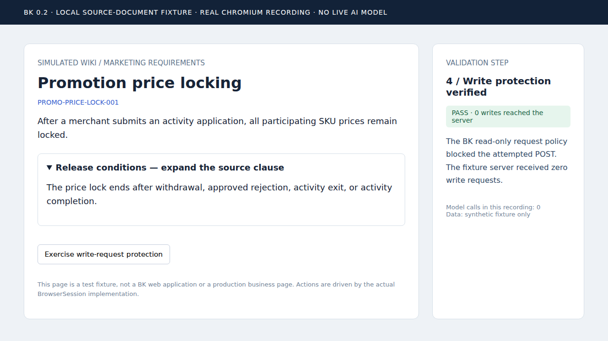

# BK 0.2.0 验证报告

运行时间：2026-11-05T06:17:56.244Z 至 2026-11-05T06:18:29.581Z（UTC；北京时间加 8 小时）。

**结论：工程验证通过；完整 V1 验收尚未完成。**

## 检查结果

| 检查 | 结果 | 原始证据 |
| --- | --- | --- |
| 自动测试 | 42/42 通过，0 失败，0 跳过 | [逐项日志](logs/tests-spec.log) · [JUnit](junit.xml) · [TAP](logs/tests.tap) |
| typecheck | 退出码 0，1758 ms | [日志](logs/typecheck.log) |
| validation-typecheck | 退出码 0，2333 ms | [日志](logs/validation-typecheck.log) |
| build | 退出码 0，1649 ms | [日志](logs/build.log) |
| format | 退出码 0，1499 ms | [日志](logs/format.log) |
| package | 退出码 0，2407 ms | [日志](logs/package.log) |

## 可复查的场景

1. **真实 Git 流程**：首次来源生成提案；在隔离测试仓库模拟人工合并；来源不变时无新增模型调用；修改一条释放条件后只形成该规则与其索引的补丁；未审核版本未改正式工作树。[执行结果](pipeline-results.json) · [实际补丁](knowledge-proposal.patch)。此场景使用确定性的模型替身，不代表真实 Claude 语义判断已验证。
2. **真实 Chromium 流程**：展开折叠条款并断言可提取；在新导航中回放 Recipe 并比较正文；通过 BK 请求策略阻断 POST，断言服务器收到 0 次写请求。此录屏没有调用模型。

## 截图与视频

[真实浏览器录屏（MP4）](browser-validation.mp4) · [实际 Recipe](browser-recipe.json)

| 截图 | 对应断言 |
| --- | --- |
| [展开前](01-source-collapsed.png) | 隐藏释放条件尚未进入可见正文 |
| [展开后](02-source-expanded.png) | 读取到了释放条件 |
| [请求保护](03-write-protection.png) | POST 被阻断，服务器写请求为 0 |

画面为合成的本地 Wiki 来源页，不是 BK Web UI，不是生产业务系统，也不是真实 Claude 自主操作的录屏。视频由浏览器 CDP 实际帧按采集时间编码，非生成图片或结果示意图。截图只能证明对应可视状态，不能单独证明全部测试通过。

## 环境与代码追溯

Node：v24.22.1；Chromium：153.0.8010.0；视口：1280×720。

[运行元数据与源码 SHA-256](manifest.json) 记录基础 checkout、未提交增量、完整命令、耗时及逐文件指纹。本地验证包含同批提交的证据生成脚本及请求策略导出改动，因此不把基础 checkout SHA 单独描述为全部被测代码。后续 CI 在对应提交上生成同类证据。

[SHA256SUMS](SHA256SUMS) 可用于校验报告、日志、截图、视频、元数据和补丁的完整性。

## 尚未证明

真实企业模型认证与业务语义质量、多模态准确率、企业 SSO、三类 Git 平台的实际审核闭环及完整真实故障注入仍需验证。工程测试中的替身结果不能作为这些事项的通过证明。详见 [剩余工作与验收门槛](REMAINING-WORK.md)。

## 复跑方式

要求 Node 24+、Git、Chromium 和 ffmpeg。先执行 npm ci、npx playwright install --with-deps chromium，再执行 npm run validate:artifacts。

默认产物在 .bk/validation/latest/；BK_VALIDATION_DIR 可指定输出目录；已有浏览器可用 BK_CHROMIUM_EXECUTABLE_PATH 指定可执行文件。CI 自动执行并将同类证据上传为 Artifact，保留 30 天。仓库中的基线证据随 Git 长期保存。
